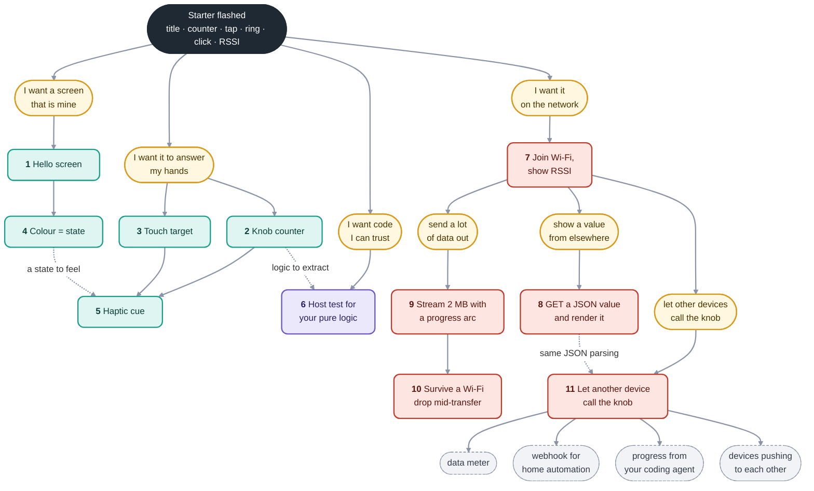

# Exercise ladder

Ten rungs and one stretch rung, drawn as a map, not a staircase. Each rung is small enough to
finish with your AI in 10–15 minutes and leaves the firmware building, flashable and host-tested.
Start from what you want the knob to do, and follow the arrows from that goal.

**Treat all of this loosely.** The rungs are inspiration, not a script, and the "Ask the AI"
lines are examples of a good prompt, not text to copy and paste. Say what you want in your own
words, skip a rung, bend one, or invent your own. When something will not build, will not flash
or behaves oddly, tell your AI tool what you see and ask it to help you find out why: getting
past obstacles and bugs together is the skill this workshop is about. And be creative. If you
have an idea for what the knob should do, ask the AI how to get there from the starter.



**How to read it.** Yellow is a goal, teal is a screen-and-hands rung, purple is the testing
rung, red is a network rung, grey is where rung 11 leads. A solid arrow means "do this first";
a dashed arrow means "easier if you have done this, not required". The numbers are names, not
an order: rung 7 is the only gate, since everything on the network needs Wi-Fi first. Rungs 6
and 10 are where the guardrails earn their keep, so take at least one of them.

**Template layout** (what the scaffold gives you):

```
components/board/   pins and capabilities — the ONLY place a GPIO number may appear
components/ui/      display + touch + LVGL bring-up, knob poll + pure decoder, backlight
components/theme/   design tokens and the colour = state policy (no LVGL dependency)
components/haptic/  DRV2605L click
components/net/     Wi-Fi join, HTTP GET, streamed HTTP PUT through one 16 KB PSRAM chunk,
                    a small HTTP server (GET /status, POST /data) for being called
components/app/     the state machine: knob/touch events in, theme/haptic/net calls out
main/main.c         boot order: NVS → ui → haptic → net → app
test/host/          gcc + Unity suites for the pure modules; scripts/test.sh runs them
scripts/            build.sh (Docker), flash.sh (host esptool --no-stub), test.sh, check-board-pins.sh
```

**API you will touch:** `knob_init(cb)`, `haptic_click()`, `theme_state_color(state)`,
`theme_state_motion_ms(state)`, `net_init()`, `net_is_connected()`, `net_rssi()`,
`net_http_get(url, buf, cap)`, `net_http_put_stream(url, total_len, rewind_cb, read_cb, ctx, progress_cb)`,
`net_serve_start(sink, max_body)`.

**Receiver for rungs 9–10:** `python3 templates/receiver/receiver.py --port 8080` on your laptop
(same Wi-Fi as the knob). It prints bytes received, throughput, and which byte ranges it holds.

---

## UI half

The template already runs a title, a knob counter, a tap toggle, a state ring, a haptic click
and an RSSI line. Every rung **adapts** that working app; nothing is built from nothing.
Widgets live in `components/app/app_screen.c`, behaviour in `components/app/app.c`.

### Rung 1 — Hello screen
- **Goal:** your own title text in Muli 28, plus a separate small label for the state name.
- **Done when:** both are readable inside the 340 px safe circle after a flash, and the title
  is no longer overwritten when the state changes.
- **Ask the AI:** "In `app_screen.c`, set the title to '<your text>' with `font_muli_28` and
  add a state label so `app_screen_set_state()` writes there instead."
- **Trap:** the AI reaches for `lv_font_montserrat_28` or LVGL 8 calls (`lv_obj_set_style_local_*`).
  The template pins LVGL 9.6.
- **Touches:** `components/app/app_screen.c`.

### Rung 2 — Knob counter
- **Goal:** a number that follows the knob, one step per detent, both directions.
- **Done when:** ten clockwise detents give +10, no skipped or doubled steps at normal speed.
- **Ask the AI:** "Make `on_knob_step` in `app.c` wrap the counter at 0..99 in both directions."
- **Trap:** the AI replaces the 3 ms poll + `knob_decode.c` with PCNT or a quadrature driver.
  This knob is not quadrature; keep the decoder.
- **Touches:** `components/app/app.c`.

### Rung 3 — Touch target
- **Goal:** a second tap zone (a small circle) that toggles its own flag; the existing
  whole-screen tap keeps toggling IDLE/ACTIVE.
- **Done when:** tapping the circle flips it and the screen shows it; the knob still works.
- **Ask the AI:** "Add a 56 px `lv_obj` circle at the bottom of the safe circle with its own
  `LV_EVENT_SHORT_CLICKED` handler that flips a bool and re-renders."
- **Trap:** `LV_EVENT_CLICKED` also fires after a long press, and the screen already uses
  `LV_EVENT_LONG_PRESSED`. Handlers never call into net or block.
- **Touches:** `components/app/app_screen.c`, `components/app/app.c`.

### Rung 4 — Colour = state
- **Goal:** idle shows the teal accent, active shows the red one, using `theme_state_color()`
  and the motion period from `theme_state_motion_ms()` for a breathing ring or arc.
- **Done when:** the colour comes from the theme, not a literal hex in the UI file.
- **Ask the AI:** "Drive an arc's colour from `theme_state_color()` and animate its opacity with
  the state's motion period."
- **Trap:** hard-coded `0xC0392B` in `app.c`; or an animation that redraws the full screen every
  frame (no TE line → tearing, and the QSPI bus is the bottleneck).
- **Touches:** `components/app/app.c`, `components/theme/` only if you add a state.

### Rung 5 — Haptic cue
- **Goal:** one click on every state change.
- **Done when:** you feel it, and the UI does not stutter.
- **Ask the AI:** "Play a different `haptic_play()` effect per state transition, exactly once each."
- **Trap:** calling I2C from inside an LVGL animation callback; the haptic shares the touch bus.
- **Touches:** `components/app/app.c`.

### Rung 6 — Host test for your pure logic
- **Goal:** the counter/state logic lives in a file with no ESP-IDF or LVGL includes, and a Unity
  suite in `test/host/` covers it.
- **Done when:** `scripts/test.sh` runs your new suite green, and `scripts/check-board-pins.sh`
  still passes.
- **Ask the AI:** "Extract the counter and state rules into `app_logic.c` with no hardware
  includes, and add `test/host/test_app_logic.c` following `test_knob_decode.c`."
- **Trap:** the AI "tests" by mocking LVGL. If the module needs a mock, it is not pure yet.
- **Touches:** `components/app/app_logic.c`, `test/host/test_app_logic.c`, `scripts/test.sh`.

---

## Network half

### Rung 7 — Join Wi-Fi, show RSSI
- **Goal:** the knob joins your Wi-Fi and the screen shows the signal in dBm, refreshed every second.
- **Done when:** RSSI updates on screen, "weak" appears below −75 dBm, the boot log shows an IP.
- **Ask the AI:** "Move the RSSI line in `app.c` to its own 1 s `lv_timer`, append 'weak' below
  −75 dBm, and log the internal heap once after the first IP."
- **Trap:** the AI commits `wifi_secrets.h` (it is gitignored, keep it so) or polls Wi-Fi from
  the LVGL task with a blocking wait. The knob is 2.4 GHz only: if your router names its 2.4
  and 5 GHz networks separately, give it the 2.4 GHz one.
- **Touches:** `components/net/include/wifi_secrets.h`, `components/app/app.c`.

### Rung 8 — GET a JSON value and render it
- **Goal:** fetch a small JSON document over HTTP and render one field.
- **Done when:** the value appears on screen; a failed request shows an error state, not a crash.
- **Ask the AI:** "On a knob press-equivalent (long touch), `net_http_get()` a URL into a 1 KB
  buffer, parse one field with cJSON, and show it."
- **Trap:** a 64 KB response buffer on the stack; running the request on the LVGL task.
  Do it on the net task and hand the result back through a callback.
- **Touches:** `components/app/app.c`, maybe `components/net/net_http.c`.

### Rung 9 — Stream ≥ 2 MB with a progress arc
- **Goal:** push a generated 2 MB payload to the receiver in 16 KB chunks, with a progress arc
  and the internal-heap low-water mark in the log after every 256 KB.
- **Done when:** the receiver reports the full byte count, and the logged minimum free internal
  heap never drops below the floor printed at boot.
- **Ask the AI:** "Use `net_http_put_stream()` with a read callback that fills the shared chunk
  from a counter pattern; update an arc from the progress callback; log
  `heap_caps_get_minimum_free_size(MALLOC_CAP_INTERNAL)` periodically."
- **Trap:** `malloc(2 * 1024 * 1024)` in internal RAM; building the whole body before sending;
  forgetting `Content-Length` so the server rejects the stream.
- **Touches:** `components/app/app.c`, `components/net/`.

### Rung 10 — Survive a Wi-Fi drop mid-transfer
- **Goal:** turn the access point off for ten seconds during rung 9; the upload resumes from the
  last acknowledged chunk without a reboot.
- **Done when:** the receiver ends with the full byte count and no duplicate ranges.
- **Ask the AI:** "Split the payload into fixed-size parts using `upload_plan.c`, ask the receiver
  which parts it has, and retry the missing ones with a bounded retry and delay."
- **Trap:** infinite retry loops; reusing a half-written HTTP client; retries that re-send from
  byte 0.
- **Touches:** `components/net/`, `components/app/app.c`, `test/host/test_upload_plan.c`.

### Rung 11 (stretch) — Let another device call the knob
- **Goal:** the knob receives a small JSON body over HTTP and shows one number from it. The
  template already answers `GET /status` and counts the bytes of a `POST /data`.
- **Done when:** `curl --data '{"value":42}' http://<knob-ip>/data` puts 42 on the screen, a
  300 KB body gets a 413, and the min-free internal heap in the log is unchanged afterwards.
- **Ask the AI:** "In `app_serve.c`, keep bodies up to 1 KB in a static buffer in the sink, and
  on the 200 ms LVGL tick in `app.c` parse `value` with cJSON and show it. No LVGL in the sink."
- **Trap:** the AI parses or draws inside the sink (it runs on the HTTP server task), allocates
  a buffer per request, assumes the body arrives in one piece, or writes a new server instead
  of using `net_serve.c`.
- **Touches:** `components/app/app_serve.c`, `components/app/app.c`.
- **Where this leads:** the same two routes cover a lot of ground.
  - A simple data meter: something POSTs a number, the knob shows it.
  - A webhook endpoint in a home automation setup.
  - Your coding agent sending messages about the progress of its work.
  - Devices that talk to each other by pushing when something happens, without constant polling.
  - Other devices reading sensor or application state off your knob through `GET /status`.

---

## Prompt card

**Good prompts** (specific, name the file, state the constraint):

1. "Read `components/board/include/board_jc3636k518c.h` first; use only those macros for pins."
2. "Keep every new file under 300 lines and put pure logic in a file with no ESP-IDF includes."
3. "Use the LVGL 9 API that `esp_lvgl_port` 2.x exposes; do not use LVGL 8 style functions."
4. "Run `scripts/build.sh` and `scripts/test.sh` and show me the output before you say it works."
5. "Allocate anything over 4 KB with `heap_caps_malloc(.., MALLOC_CAP_SPIRAM)` and explain why."
6. "Do the network call on the net task and deliver the result to the UI through a callback."

**Bad prompts** (and why they bite):

1. "Make the knob work." — The AI picks a quadrature driver. This knob is not one.
2. "Add Wi-Fi and upload the file." — Invites a whole-file buffer in internal RAM and a crash.
3. "Use the pins from the Waveshare example." — There are several boards with that name; the
   AI will mix pin maps. The board header is the only source.
4. "Just fix the warnings." — Strapping warnings on GPIO45/46 are expected; "fixing" them
   breaks the mic and sometimes the boot.

<style>
  .rung-map { cursor: zoom-in; }
  .rung-map.zoomed { position: fixed; inset: 0; z-index: 10; margin: 0; padding: 24px; overflow: auto;
                     background: #fff; cursor: zoom-out; }
  .rung-map.zoomed svg { max-width: none !important; width: 1300px; height: auto; display: block; margin: 0 auto; }
  .rung-map p { margin: 0; }
</style>
<script type="module">
  // The published site does not draw mermaid blocks by itself; this turns the block at the top into the graph.
  // Click the graph to see it full size, click again (or a rung) to go back.
  import mermaid from "https://cdn.jsdelivr.net/npm/mermaid@11.4.1/dist/mermaid.esm.min.mjs";
  document.querySelectorAll("div.language-mermaid, pre > code.language-mermaid").forEach((block) => {
    const graph = document.createElement("div");
    graph.className = "mermaid rung-map";
    graph.title = "Click to enlarge";
    graph.textContent = block.textContent;
    graph.addEventListener("click", (e) => {
      if (e.target.closest("a")) graph.classList.remove("zoomed");
      else graph.classList.toggle("zoomed");
    });
    (block.tagName === "CODE" ? block.parentElement : block).replaceWith(graph);
  });
  mermaid.initialize({ startOnLoad: false, securityLevel: "loose",
    fontFamily: "Noto Sans, Helvetica Neue, Helvetica, Arial, sans-serif" });
  await document.fonts.ready;   // measure labels with the font they are drawn in
  mermaid.run();
</script>
