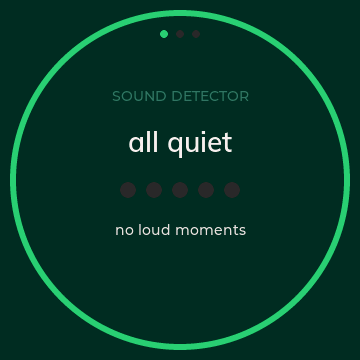
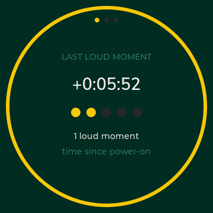
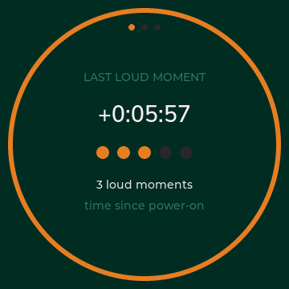
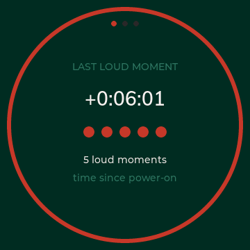
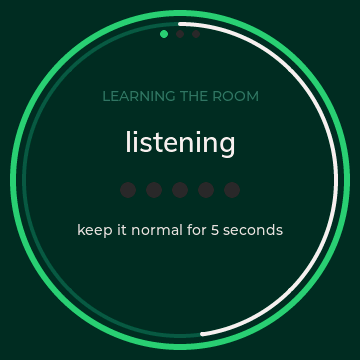
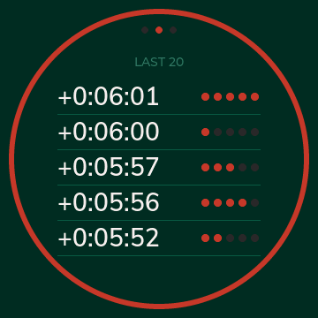
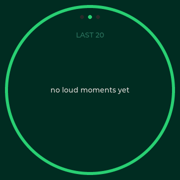
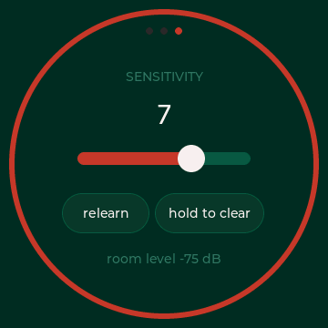

# sound-detector

A desk device that learns what "normal" sounds like in the room and shows at a glance whether
it got loud. Runs on the Guition JC3636K518C / Waveshare ESP32-S3-Knob-Touch-LCD-1.8 (ESP32-S3R8,
1.8" 360×360 round display, touch, rotary knob, PDM microphone, DRV2605L haptics). Built from
the IDA workshop `knob-starter` template; the requirements are in `userstory.md`.

## The spec for the system

This user story (`userstory.md`, reproduced word for word) is the whole
specification the firmware was built from.

> As someone who wants to know whether it got loud while I wasn't paying attention, I want a small device on my desk that
> learns what "normal" sounds like in my room and tells me at a glance when something louder happened, so that I don't have to
> listen for it myself or guess afterwards.
>
> How it works for me
>
> - It learns my room. The first time I switch it on, it listens quietly for five seconds to learn the normal background level.
>   I can ask it to do this again whenever the room changes.
> - One look tells me the answer. A coloured ring shows how many loud moments there have been: green for none, yellow for one,
>   orange for a few, red for five or more.
> - It counts sensibly. A long or stuttering noise counts as one event, not dozens.
> - I can see what happened. The main screen shows when the last loud moment was and how strong it was, on a scale of one to
>   five dots. A second screen lists the last 20, newest first.
> - I decide how touchy it is. A slider from 1 to 10 sets how much louder than normal a sound must be before it counts.
> - I can start fresh. One button clears the count and the list, and the ring goes back to green.
> - It's easy to handle. I swipe or turn the knob to move between the three screens, and I feel a small click when something
>   registers.
> - It stays out of the way. After 20 seconds untouched it dims and returns to the main screen.
> - It works without internet. With Wi-Fi it shows the real time of each event; without it, it shows time since it was switched
>   on.
> - It remembers my settings. The learned room level and my sensitivity setting survive a restart. The list of events does not.

## What it does

- Learns the room level for 5 seconds on first power-on; "relearn" on the settings screen redoes it.
- The ring shows the count of loud moments: green 0, yellow 1, orange 2–4, red 5 or more.
- A long or stuttering noise is one event (it ends after 1.5 s of quiet).
- Home shows when the last loud moment was and its strength (1–5 dots); the second screen lists
  the last 20, newest first; the third has the sensitivity slider (1–10), relearn and
  "hold to clear".
- Swipe left/right or turn the knob to change screen (it wraps). A click is felt on each event.
- After 20 s untouched it dims and returns to Home.
- With Wi-Fi it shows clock times; without, time since power-on (`+H:MM:SS`).
- The room level and the sensitivity survive a restart; the event list does not.

## Screens

Pixel-exact framebuffer captures from the device (`scripts/testctl.py snap`), not photos.
Without Wi-Fi the times are time since power-on, as shown here.

**Home** — the ring colour is the answer at a glance.

| No loud moments | One | A few (2–4) | Five or more |
|---|---|---|---|
|  |  |  |  |

**Learning, list and settings**

| Learning the room | Last 20 | Last 20, empty | Settings |
|---|---|---|---|
|  |  |  |  |

## Layout

```
components/board/    pins + capabilities (the ONLY place a GPIO number may appear; linted)
components/ui/       ST77916 + CST816 + LVGL bring-up, knob driver, backlight, Muli 28 font
components/theme/    design tokens + colour policy (state colours, loud-count ring colour)
components/haptic/   DRV2605L on the touch I2C bus
components/mic/      PDM microphone task (mic.c) + DC blocker and level meter (mic_level.c, pure)
components/sound/    pure logic: detector.c, event_log.c, event_time.c
components/settings/ room level + sensitivity in NVS, written by a debounced task
components/net/      Wi-Fi STA (net.c) and SNTP clock (net_time.c); optional at runtime
components/app/      app.c (state + inputs), app_monitor.c (detector on the mic task),
                     app_nav.c (three screens, swipe/knob), screen_*.c, app_widgets.c
components/testctl/  dev-only serial test console (CONFIG_KNOB_TESTCTL)
main/main.c          boot order
test/host/           Unity suites for every pure module
docs/                screenshots used in this README
scripts/             build.sh (Docker), flash.sh (host esptool), test.sh (gcc), bootlog.py,
                     testctl.py + verify-screens.sh (drive the device over USB)
```

## Build, flash, test

```bash
cp components/net/include/wifi_secrets.example.h components/net/include/wifi_secrets.h  # edit it
scripts/test.sh                      # host unit tests + GPIO-literal lint, no IDF needed
scripts/build.sh                     # docker espressif/idf:release-v5.3 → build/sound_detector.bin
scripts/flash.sh                     # host esptool --no-stub over /dev/ttyACM0 (full image)
scripts/flash.sh /dev/ttyACM0 app    # later: app image only
scripts/bootlog.py 10                # reset the knob and print its log for 10 s
scripts/verify-screens.sh            # scripted walk with snapshots, evidence in build/verify/
```

Flash from the host, never from the container. `--no-stub` is required on this board's native
USB. The USB-C plug orientation picks the chip: `303a:1001` (`/dev/ttyACM0`) is the S3 you
flash; `1a86:7523` is the Bluetooth sidecar — flip the plug.

Wi-Fi is optional and only used for the time of day. The time zone is `NET_TIME_TZ` in
`components/net/net_time.c` (Central European Time by default).

## Test console (over the same USB port)

```
scripts/testctl.py state       -> screen=home count=0 sens=5 cal=ok dim=0 listen=1
scripts/testctl.py knob +1     next screen (knob -1: previous)
scripts/testctl.py loud 3      a loud moment of strength 3, through the real handler
scripts/testctl.py sens 7      move the sensitivity slider
scripts/testctl.py clear | relearn | idle | reset
scripts/testctl.py listen 0    ignore the microphone (scripted walks); listen 1 to resume
scripts/testctl.py mic         -> level=-74.20 peak=-71.05 base=-75.00 thr=-57.00   (dBFS)
scripts/testctl.py selftest    -> quiet=-66.52 click=-45.86 delta=20.66 (mic vs haptic click)
scripts/testctl.py snap a.png  pixel-exact LVGL screenshot
```

## Tuning

- `components/sound/detector.c`: `MARGIN_CDB` (how many dB over the room level each sensitivity
  step needs), `STRENGTH_STEP_CDB` (dB per strength dot), `DETECTOR_QUIET_MS` in the header.
- `components/app/app.c`: `IDLE_MS`, `HAPTIC_MUTE_MS` (the mic hears the haptic motor, so it is
  ignored for this long after every click).

## Build stats

Taken from the Claude Code message log of the session that built this firmware
(`~/.claude/projects/-home-dalager-projects-sounddetector/805491d2-….jsonl` plus its two
subagent logs), read at 22:08 CET on 2026-11-16.

**Time.** 43 minutes of wall-clock time, from the first request (21:19:25 CET) to the summary
of the finished, flashed and verified firmware (22:02:33 CET). That includes the time spent
waiting for a person: flipping the USB plug, answering three planning questions and approving
the plan. Firmware builds in Docker and flashing are in there too.

**Models.**

| Role | Model | API responses |
|---|---|---|
| Main session: planning, all code, build, flash, on-device verification | `claude-fable-5-2` | 79 |
| Independent "find the bug" code review (subagent) | `claude-fable-5-2` | 14 |
| Exploration of the workshop template before planning (subagent) | `claude-opus-5-5` | 14 |

**Tokens.**

| | Output | Input (uncached) | Cache writes | Cache reads |
|---|---|---|---|---|
| Main session | 134,780 | 172 | 297,593 | 17,783,335 |
| Review subagent | 34,700 | 28 | 173,649 | 1,637,554 |
| Exploration subagent | 13,858 | 28 | 193,326 | 1,446,374 |
| **Total** | **183,338** | **228** | **664,568** | **20,867,263** |

How to read these numbers:

- Output tokens are what the models wrote (reasoning, code, commands). The large cache-read
  figure is the conversation being re-read from the prompt cache on every step; it is billed at
  a fraction of the normal input price and is not new text.
- The token totals run to 22:08, so they also include the small follow-up task of taking the
  README screenshots (about 3 minutes after the build), and exclude whatever was logged after
  that moment, including the writing of this section. The log does not separate the build from
  the follow-up, so the build alone used somewhat less than the totals shown.
- The local Lemonade/Qwen model was not used.
